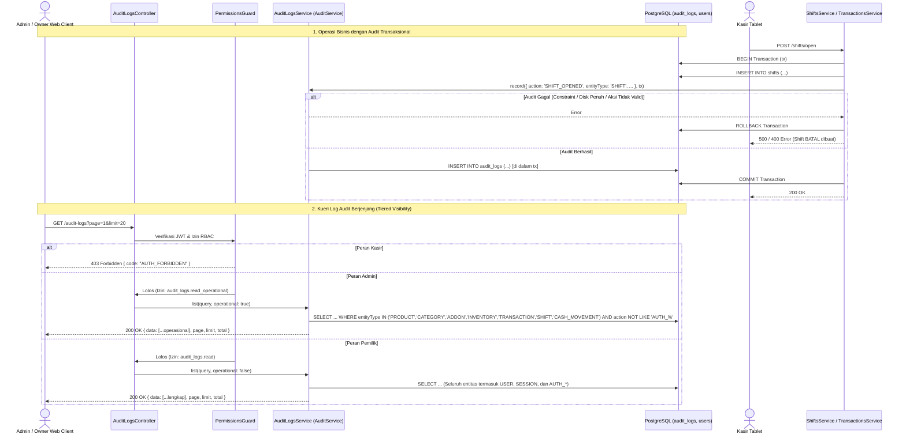

# Arsitektur Layanan dan Endpoint Audit Log (District 13)

Dokumen ini merupakan spesifikasi resmi dan panduan teknis implementasi untuk modul **Audit dan Pengaturan (SET)** pada **Milestone M1**:

- **T-19 (Issue #42)**: `[SET] Layanan dan endpoint audit log (T-19)`

Implementasi ini memenuhi persyaratan sistem dari **SRS v0.1**:

- **REQ-F-SET-001**: Sistem HARUS mencatat log audit untuk void, penyesuaian stok, perubahan harga, pengelolaan diskon, perubahan pengguna, perubahan pengaturan toko, perubahan catatan kas, dan penutupan shift, memuat pelaku, waktu, dan nilai sebelum/sesudah. Log TIDAK BOLEH dapat diubah atau dihapus oleh pengguna aplikasi.
- **REQ-F-SET-002**: Sistem HARUS menampilkan log audit lengkap hanya kepada Pemilik, dan log audit operasional kepada Admin.
- **REQ-NFR-SEC-04**: Sistem HARUS menyimpan log audit secara aman dan tidak dapat dirusak (_tamper-proof_).
- **Kriteria Keberterimaan (AC)**: Gagal menulis audit membatalkan perubahan yang diaudit (_transactional rollback_).

---

## 1. Arsitektur Audit & Penjaminan Atomik Transaksi (AC)



### 1.1 Penjaminan Atomik Transaksi (AC)

Layanan [AuditLogsService](file:///home/syarief/projects/district-13/backend/src/audit-logs/audit-logs.service.ts) (diekspor juga dengan alias `AuditService`) menerima eksekutor transaksi `executor`:

```typescript
async record(
  input: {
    userId?: string | null;
    action: (typeof AUDIT_ACTIONS)[number];
    entityType: string;
    entityId?: string | null;
    description: string;
    metadata?: unknown;
  },
  executor = this.database.db,
)
```

Ketika pemanggil meneruskan transaksi aktif (`tx`), kegagalan apa pun saat menulis ke tabel `audit_logs` melempar _exception_ yang langsung membatalkan (_rollback_) seluruh perubahan pada operasi bisnis yang bersangkutan (misal pembukaan shift, pembuatan penjualan, atau pemindahan stok).

### 1.2 Ketidakdapat-ubahan Lapis Basis Data (_Immutable Append-Only_)

Sesuai **REQ-F-SET-001**, log audit tidak boleh dapat diubah atau dihapus. Hal ini diamankan di tingkat PostgreSQL melalui trigger trigger proteksi:

```sql
CREATE TRIGGER trg_prevent_audit_logs_mutation
BEFORE UPDATE OR DELETE ON audit_logs
FOR EACH ROW
EXECUTE FUNCTION prevent_audit_logs_mutation();
```

Trigger ini menolak segala operasi `UPDATE` maupun `DELETE` dengan pesan kesalahan tegas `Audit logs are append-only and cannot be modified or deleted`.

---

## 2. Sanitasi Data Rahasia (_Sensitive Data Scrubbing_)

Untuk mencegah kebocoran kredensial atau informasi sensitif pada tabel audit, fungsi `sanitizedAuditMetadata()` membersihkan secara rekursif setiap kunci metadata yang cocok dengan pola:

```typescript
const SECRET_KEY = /password|token|cookie|secret|credential/i;
```

Bidang-bidang seperti kata sandi teks polos, JWT token, cookie sesi, dan rahasia klien secara otomatis dihapus sebelum data disimpan ke kolom JSONB `metadata`.

---

## 3. Tingkat Visibilitas Berbasis Peran (REQ-F-SET-002)

| Peran Pengguna        |  Tingkat Akses  | Cakupan Entitas yang Ditampilkan                                                                                                                                                                                             | Rujukan Izin RBAC             |
| :-------------------- | :-------------: | :--------------------------------------------------------------------------------------------------------------------------------------------------------------------------------------------------------------------------- | :---------------------------- |
| **Pemilik (`owner`)** |   **Lengkap**   | Seluruh entitas tanpa batasan: `USER`, `SESSION`, `PRODUCT`, `CATEGORY`, `ADDON`, `INVENTORY`, `TRANSACTION`, `SHIFT`, `CASH_MOVEMENT`, `SCHEDULE`, `SETTING`, serta seluruh log autentikasi (`AUTH_*`).                     | `audit_logs.read`             |
| **Admin (`admin`)**   | **Operasional** | Khusus entitas operasional harian: `PRODUCT`, `CATEGORY`, `ADDON`, `INVENTORY`, `TRANSACTION`, `SHIFT`, `CASH_MOVEMENT`. Dilarang melihat data pengguna (`USER`), sesi (`SESSION`), dan peristiwa keamanan/login (`AUTH_*`). | `audit_logs.read_operational` |
| **Kasir (`cashier`)** |   **Ditolak**   | Tidak memiliki hak akses melihat log audit. Mengembalikan **HTTP 403 Forbidden** (`AUTH_FORBIDDEN`).                                                                                                                         | —                             |

Filter SQL operasional yang diterapkan secara otomatis untuk Admin:

```sql
audit_logs.entity_type IN ('PRODUCT','CATEGORY','ADDON','INVENTORY','TRANSACTION','SHIFT','CASH_MOVEMENT')
AND audit_logs.action NOT LIKE 'AUTH_%'
AND audit_logs.entity_type NOT IN ('USER','SESSION')
```

---

## 4. Spesifikasi API Endpoint `GET /audit-logs`

### Permintaan (_Request_)

- **URL**: `/audit-logs`
- **Metode**: `GET`
- **Header**: `Authorization: Bearer <access_token>`
- **Parameter Kueri**:
  - `page` (integer, opsional, bawaan: 1): Halaman data.
  - `limit` (integer, opsional, bawaan: 20, maks: 100): Jumlah rekaman per halaman.
  - `startDate` (ISO Date, opsional): Batas awal waktu (inklusif).
  - `endDate` (ISO Date, opsional): Batas akhir waktu (inklusif 23:59:59 untuk format YYYY-MM-DD).
  - `userId` (UUID, opsional): Saring berdasarkan ID pelaku.
  - `action` (string, opsional): Saring berdasarkan jenis aksi.
  - `entityType` (string, opsional): Saring berdasarkan tipe entitas.
  - `entityId` (UUID, opsional): Saring berdasarkan ID entitas target.

### Tanggapan Berhasil (`200 OK`)

```json
{
  "data": [
    {
      "id": "7f8b9c1d-1234-4567-89ab-cdef01234567",
      "userId": "3c4d5e6f-7890-1234-5678-9abcdef01234",
      "username": "admin",
      "action": "PRODUCT_PRICE_UPDATED",
      "entityType": "PRODUCT",
      "entityId": "a1b2c3d4-e5f6-7890-abcd-ef1234567890",
      "description": "Product price changed from 25000 to 28000",
      "metadata": {
        "before": { "price": 25000 },
        "after": { "price": 28000 }
      },
      "createdAt": "2026-11-18T08:30:00.000Z"
    }
  ],
  "page": 1,
  "limit": 20,
  "total": 1
}
```

### Tanggapan Kesalahan

- **400 Bad Request**: Jika `startDate > endDate` (`endDate must not precede startDate`).
- **401 Unauthorized**: Token akses tidak valid atau kedaluwarsa (`AUTH_SESSION_EXPIRED`).
- **403 Forbidden**: Pengguna Kasir mencoba memanggil endpoint (`AUTH_FORBIDDEN`).

---

## 5. Verifikasi & Pengujian

Implementasi modul ini diuji secara ketat melalui pengujian unit, guard RBAC, dan integrasi koleksi Postman:

1. **Unit Test Audit Service**: [audit-logs.service.spec.ts](file:///home/syarief/projects/district-13/backend/src/audit-logs/audit-logs.service.spec.ts)
   - Uji penulisan audit dalam transaksi (`tx`).
   - Uji pembersihan rekursif metadata rahasia (_password, token, cookie, secret_).
   - Uji kriteria keberterimaan (AC): kegagalan penulisan audit membatalkan transaksi induk.
   - Uji filter log lengkap untuk Pemilik vs operasional untuk Admin.
   - Uji validasi rentang tanggal dan paginasi.
2. **Unit Test Controller**: [audit-logs.controller.spec.ts](file:///home/syarief/projects/district-13/backend/src/audit-logs/audit-logs.controller.spec.ts)
   - Uji penanganan peran case-insensitive (`OWNER`, `owner`, `ADMIN`, `admin`).
3. **Pengujian RBAC Matriks**: [rbac-matrix-endpoints.spec.ts](file:///home/syarief/projects/district-13/backend/test/rbac-matrix-endpoints.spec.ts)
   - Memvalidasi bahwa Pemilik dapat mengakses via `audit_logs.read`.
   - Memvalidasi bahwa Admin dapat mengakses via `audit_logs.read_operational`.
   - Memvalidasi bahwa Kasir mutlak ditolak dengan HTTP 403 `AUTH_FORBIDDEN`.
4. **Kesesuaian Postman**:
   - `postman/collections/report-audit-management/03-audit/admin-list.request.yaml` (hanya entitas operasional).
   - `postman/collections/report-audit-management/03-audit/owner-list.request.yaml` (paginasi lengkap).
   - `postman/collections/report-audit-management/04-authorization/cashier-denied-audit.request.yaml` (penolakan kasir).

Perintah menjalankan pengujian:

```bash
npm test --prefix backend -- src/audit-logs/
npm test --prefix backend -- test/rbac-matrix-endpoints.spec.ts
```
