# Arsitektur Autentikasi dan Guard RBAC di Sisi Server (District 13)

Dokumen ini merupakan spesifikasi resmi dan panduan implementasi untuk modul **Pengguna dan Akses (USR)** pada **Milestone M1**:

- **T-17 (Issue #40)**: `[USR] Autentikasi: login, refresh, logout, me (T-17)`
- **T-18 (Issue #41)**: `[USR] Guard RBAC di sisi server (T-18)`

Implementasi ini memenuhi persyaratan sistem dari **SRS v0.1**:

- **REQ-F-USR-001**: Autentikasi nama pengguna dan kata sandi dengan satu peran per akun.
- **REQ-F-USR-003**: Kontrol akses matriks hak akses penuh di sisi server.
- **REQ-F-USR-004**: Penolakan login akun nonaktif dengan pemeliharaan riwayat transaksi.
- **REQ-F-USR-006**: Larangan mutlak pembukaan shift dan transaksi penjualan bagi Pemilik dan Admin.
- **REQ-NFR-SEC-01**: Penyimpanan kata sandi dengan hash aman (Argon2id) tanpa pencatatan teks polos.
- **REQ-NFR-SEC-02**: Pemeriksaan kontrol akses berbasis peran di sisi server pada setiap fungsi.
- **REQ-NFR-SEC-03**: Penguncian login selama 5 menit setelah 5 kali kegagalan berturut-turut pada akun.

---

## 1. Arsitektur Sesi & Token

```mermaid
sequenceDiagram
    actor Client as Tablet / Web POS
    participant Auth as AuthController / AuthService
    participant Guard as JwtAuthGuard & PermissionsGuard
    participant DB as PostgreSQL (users, sessions, logs)

    Note over Client, DB: 1. Alur Login & Pemeriksaan Kredensial
    Client->>Auth: POST /auth/login { username, password }
    Auth->>DB: Query user by lower(username)
    alt Akun Terkunci (locked_until > now)
        Auth-->>Client: 423 Locked { code: "AUTH_ACCOUNT_LOCKED" }
    else Akun Nonaktif (is_active = false)
        Auth-->>Client: 403 Forbidden { code: "AUTH_ACCOUNT_INACTIVE" }
    else Password Salah
        Auth->>DB: Increment failed_login_count (set locked_until jika >= 5)
        Auth-->>Client: 401 Unauthorized { code: "AUTH_INVALID_CREDENTIALS" }
    else Kredensial Valid
        Auth->>DB: Reset failed_login_count = 0, locked_until = NULL, last_activity_at = now()
        Auth->>DB: Insert new session (SHA-256 hashed refresh token)
        Auth-->>Client: 200 OK { accessToken, expiresIn: 900 } + HttpOnly Refresh Cookie + CSRF Cookie
    end

    Note over Client, DB: 2. Introspeksi Identitas & Izin
    Client->>Auth: GET /auth/me (Bearer Token)
    Auth-->>Client: 200 OK { id, username, fullName, role, permissions: [...] }

    Note over Client, DB: 3. Rotasi Refresh Token & Single-Use Enforcement
    Client->>Auth: POST /auth/refresh (Cookie: refresh_token, X-CSRF-Token)
    Auth->>DB: Validasi hash refresh token aktif (isNull(revoked_at) & expires_at > now)
    alt Token Replay / Sesi Kedaluwarsa
        Auth-->>Client: 401 Unauthorized { code: "AUTH_SESSION_EXPIRED" }
    else Sesi Valid
        Auth->>DB: Putar hash refresh token baru (atomik)
        Auth-->>Client: 200 OK { accessToken, expiresIn: 900 } + Rotated Refresh Cookie
    end
```



### 1.1 Spesifikasi Token & Cookie

1. **Access Token (JWT)**:
   - Format: JSON Web Token ditandatangani menggunakan algoritma `HS256`.
   - Masa Berlaku (_TTL_): **15 menit** (`900` detik).
   - _Claims Payload_:
     - `sub`: ID pengguna (`uuid`).
     - `role`: Peran pengguna (`owner`, `admin`, atau `cashier`).
     - `sid`: ID sesi autentikasi (`uuid` tabel `sessions`).
   - Dikirimkan klien via header `Authorization: Bearer <access_token>`.

2. **Refresh Token (Opaque Token)**:
   - Format: String acak aman 32-byte berkode `base64url`.
   - Masa Berlaku: 7 hari.
   - Penyimpanan: **Hanya hash SHA-256** yang disimpan pada tabel `sessions.refresh_token_hash`. Nilai token polos tidak pernah disimpan di basis data.
   - Atribut Cookie:
     - Nama: `refresh_token`
     - `HttpOnly`: `true` (mencegah pencurian token melalui serangan XSS).
     - `SameSite`: `Lax`.
     - `Path`: `/auth` (terisolasi hanya untuk endpoint autentikasi).
     - `Secure`: Diaktifkan pada lingkungan produksi (`NODE_ENV=production`).

3. **Perlindungan CSRF (Double Submit Cookie)**:
   - Cookie `csrf_token`: Diterbitkan dengan cakupan `Path=/` dan `httpOnly: false`.
   - Klien membaca cookie ini dan menyertakannya pada header `X-CSRF-Token` saat memanggil endpoint state-changing berbasis cookie (`POST /auth/refresh` dan `POST /auth/logout`).
   - Server memverifikasi kecocokan nilai menggunakan perbandingan konstan waktu (`timingSafeEqual`) untuk mencegah serangan _timing attack_.

---

## 2. Kebijakan Penguncian Akun (_Account Lockout_)

Sesuai ketentuan **REQ-NFR-SEC-03**:

1. Setiap kegagalan verifikasi kata sandi menambah nilai kolom `failed_login_count` pada tabel `users`.
2. Jika kegagalan mencapai **5 kali berturut-turut** (`failed_login_count >= 5`), akun secara otomatis dikunci:
   - Kolom `locked_until` diisi dengan waktu 5 menit ke depan (`now() + interval '5 minutes'`).
   - Log audit `AUTH_ACCOUNT_LOCKED` dicatat pada `auth_audit_logs`.
   - Percobaan login saat akun terkunci mengembalikan **HTTP 423 Locked** dengan kode `AUTH_ACCOUNT_LOCKED`.
3. Masa penguncian berakhir secara mandiri (_self-healing_): begitu waktu saat ini melewati nilai `locked_until`, kolom `locked_until` dibersihkan (`NULL`) dan `failed_login_count` diatur kembali ke `0`.
4. Login yang berhasil langsung menyetel kembali `failed_login_count = 0`, `locked_until = NULL`, dan mencatat `last_activity_at = now()`.
5. Perlindungan _Timing Attack_: Jika nama pengguna tidak ditemukan dalam database, sistem menjalankan verifikasi kata sandi terhadap hash boneka (_dummy Argon2id hash_) sehingga waktu eksekusi seragam dan mencegah enumerasi nama pengguna.

---

## 3. Matriks Hak Akses & Penegakan RBAC di Sisi Server

### 3.1 Katalog 57 Izin

Sistem POS District 13 menerapkan 57 izin granular yang dipetakan pada 3 peran pengguna:

- **Pemilik (`owner`)**: 55 izin (seluruh fungsi administratif, finansial, produk, dan pengaturan, kecuali operasional shift/transaksi kasir).
- **Admin (`admin`)**: 36 izin (manajemen katalog, manajemen pengguna terbatas pada kasir, pemindahan stok display, penyesuaian inventaris fisik, tutup paksa shift kasir).
- **Kasir (`cashier`)**: 14 izin (penjualan kasir, buka dan tutup shift sendiri, kas masuk/keluar laci sendiri, pembatalan nota sendiri, lihat jadwal kerja sendiri).

Rincian lengkap pemetaan 57 izin tersedia pada dokumen [rbac-matrix-data.md](file:///home/syarief/projects/district-13/docs/database/rbac-matrix-data.md).

### 3.2 Penegakan Larangan Mutlak Pemilik & Admin (REQ-F-USR-006)

Sesuai **REQ-F-USR-006**, Pemilik dan Admin dilarang keras membuka shift kasir dan membuat transaksi penjualan.
Penegakan dilakukan di beberapa lapis pertahanan (_defense in depth_):

1. **Lapis Basis Data**: Trigger `trg_prevent_owner_admin_shifts` dan `trg_prevent_owner_admin_sales` menolak pembuatan data secara langsung.
2. **Lapis Guard Server**: `PermissionsGuard` secara eksplisit memeriksa:
   ```typescript
   const normalizedRole = user.role.toLowerCase();
   if (normalizedRole === "owner" || normalizedRole === "admin") {
     const allPermissions = [
       ...(requiredPermissions ?? []),
       ...(anyPermissions ?? []),
     ];
     if (
       allPermissions.includes(PERMISSIONS.shiftsOpen) ||
       allPermissions.includes(PERMISSIONS.transactionsCreate)
     ) {
       throw new ForbiddenException({
         statusCode: 403,
         code: "AUTH_FORBIDDEN",
         message:
           "Owner and Admin are strictly prohibited from opening shifts and creating sales transactions (REQ-F-USR-006)",
       });
     }
   }
   ```

### 3.3 Penggunaan Dekorator Izin

Untuk mengamankan rute controller, gunakan dekorator berikut:

```typescript
import { RequirePermission, RequireAnyPermissions } from '../auth/decorators/require-permission.decorator.js';
import { AuthenticatedOnly } from '../auth/decorators/permissions.decorator.js';
import { PERMISSIONS } from '../auth/permissions/permissions.js';

// Memerlukan seluruh izin yang disebutkan
@RequirePermission(PERMISSIONS.productsCreate)
@Post()
createProduct(...) {}

// Memerlukan salah satu dari izin yang disebutkan
@RequireAnyPermissions(PERMISSIONS.transactionsReadOwn, PERMISSIONS.transactionsReadAll)
@Get(':id')
getTransactionDetail(...) {}

// Hanya memerlukan autentikasi aktif (misal endpoint /auth/me)
@AuthenticatedOnly()
@Get('me')
getProfile(...) {}
```

---

## 4. Aturan Kepemilikan Data (_Ownership Verification_)

Sesuai aturan bisnis, Kasir hanya boleh mengakses atau mengubah data miliknya sendiri ("sendiri"):

- **Shift Kasir**: Kasir hanya dapat melihat ringkasan shift sendiri (`shifts.view_self`) dan menutup shift sendiri (`shifts.close_self`).
- **Transaksi Kasir**: Kasir hanya dapat melihat riwayat transaksi sendiri (`sale.view_self`) dan membatalkan nota transaksi buatannya sendiri (`sale.void`).
- **Mutasi Kas Laci**: Kasir hanya dapat mencatat uang masuk/keluar pada laci shift aktif miliknya sendiri (`cash_movement.create_self`).

Layanan pembantu [OwnershipService](file:///home/syarief/projects/district-13/backend/src/auth/ownership/ownership.service.ts) menyediakan verifikasi ini:

```typescript
await this.ownershipService.assertShiftOwnership(shiftId, actor);
await this.ownershipService.assertTransactionOwnership(transactionId, actor);
```

Jika ID pemilik tidak cocok dengan ID pengguna penyeru, server melemparkan **HTTP 403 Forbidden** dengan kode `AUTH_FORBIDDEN`.

---

## 5. Katalog Kode Kesalahan Standar

| Kode Kesalahan             |    HTTP Status     | Situasi Pemicu                                                                                                                 |
| :------------------------- | :----------------: | :----------------------------------------------------------------------------------------------------------------------------- |
| `AUTH_INVALID_CREDENTIALS` | `401 Unauthorized` | Nama pengguna atau kata sandi tidak valid.                                                                                     |
| `AUTH_ACCOUNT_LOCKED`      |    `423 Locked`    | Akun terkunci sementara selama 5 menit akibat 5 kali berturut-turut gagal login.                                               |
| `AUTH_ACCOUNT_INACTIVE`    |  `403 Forbidden`   | Akun berstatus nonaktif (`is_active = false`). Percobaan masuk ditolak.                                                        |
| `AUTH_SESSION_EXPIRED`     | `401 Unauthorized` | Token akses atau refresh tidak valid, kedaluwarsa, sesi dicabut, atau token lama diputar ulang (_replay_).                     |
| `AUTH_FORBIDDEN`           |  `403 Forbidden`   | Peran akun tidak memiliki izin yang dibutuhkan untuk mengakses endpoint, atau melanggar aturan larangan peran (REQ-F-USR-006). |

Format payload JSON standar:

```json
{
  "statusCode": 403,
  "code": "AUTH_FORBIDDEN",
  "message": "Owner and Admin are strictly prohibited from opening shifts and creating sales transactions (REQ-F-USR-006)"
}
```

---

## 6. Verifikasi & Pengujian

Seluruh skenario autentikasi dan RBAC telah teruji secara komprehensif melalui suite pengujian otomatis:

- Unit Test Layanan Autentikasi: [auth.service.spec.ts](file:///home/syarief/projects/district-13/backend/src/auth/auth.service.spec.ts) (11 pengujian)
- Unit Test Controller Autentikasi: [auth.controller.spec.ts](file:///home/syarief/projects/district-13/backend/src/auth/auth.controller.spec.ts) (4 pengujian)
- Unit Test Guard RBAC Server: [permissions.guard.spec.ts](file:///home/syarief/projects/district-13/backend/src/auth/guards/permissions.guard.spec.ts) (8 pengujian)
- Unit Test Layanan Kepemilikan: [ownership.service.spec.ts](file:///home/syarief/projects/district-13/backend/src/auth/ownership/ownership.service.spec.ts) (4 pengujian)
- Pengujian Matriks RBAC Endpoint: [rbac-matrix-endpoints.spec.ts](file:///home/syarief/projects/district-13/backend/test/rbac-matrix-endpoints.spec.ts) (11 pengujian)

Perintah menjalankan pengujian:

```bash
npm test --prefix backend -- src/auth/
npm test --prefix backend -- test/rbac-matrix-endpoints.spec.ts
```
