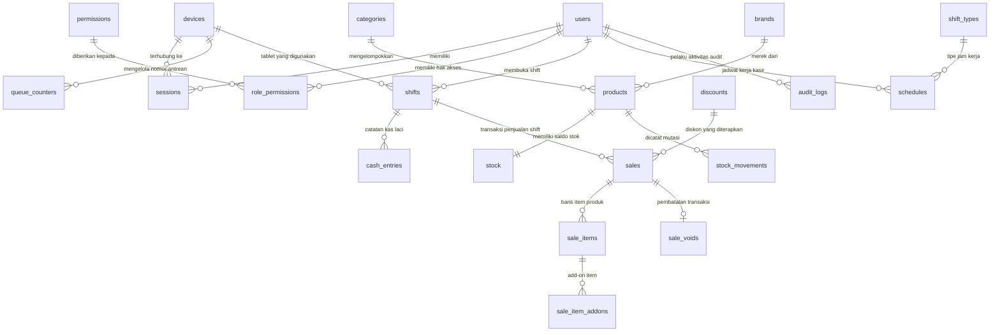

# Arsitektur & Spesifikasi Database "District 13" (Modul DB: T-09 – T-16)

Dokumen ini mendokumentasikan desain, implementasi skema, migrasi berversi, proteksi integritas tingkat basis data (_triggers & append-only_), serta data benih (_seed_) untuk sistem Point of Sale (POS) **District 13**. Arsitektur ini mengimplementasikan spesifikasi resmi dari **SRS v0.1 Bagian 2.2**, **System Design Document (SDD) Bagian 5.3–5.5**, dan keputusan arsitektur final **B-02 / B-04**.

---

## 1. Ikhtisar Modul & Daftar Task (P0)

Modul Database mencakup 8 task berstatus `P0 (blocker)`:

| ID Task  | Issue | Judul & Ruang Lingkup                                                                                                                                                                                           | Ketergantungan | Dokumen Acuan                                         |
| :------- | :---- | :-------------------------------------------------------------------------------------------------------------------------------------------------------------------------------------------------------------- | :------------- | :---------------------------------------------------- |
| **T-09** | #32   | **Ekstensi, ENUM & Fungsi Dasar**: `pg_trgm`, 9 tipe ENUM, sequence `master_updated_seq`, fungsi trigger `trg_set_updated_at()`, `trg_set_updated_meta()`, `trg_append_only()`.                                 | T-06           | SDD 5.3 Bagian 1                                      |
| **T-10** | #33   | **Pengguna, Hak Akses, Perangkat & Sesi**: Tabel `users`, `permissions`, `role_permissions`, `devices`, `sessions`. Konstrain huruf kecil, hash kata sandi Argon2id, indeks sesi.                               | T-09           | USR-001, USR-003, SDD 5.3 Bagian 2                    |
| **T-11** | #34   | **Katalog Produk**: Tabel `categories`, `brands`, `addons`, `discounts`, `products`. Indeks unik SKU/barcode, trigram GIN nama produk, konstrain harga ≥ 0, urutan versi `updated_seq`.                         | T-09           | PRD-001, PRD-003, PRD-006, SDD 5.3 Bagian 3           |
| **T-12** | #35   | **Inventaris & Pergerakan Stok**: Pemisahan stok gudang (`warehouse_qty`) dan display (`display_qty`). Trigger auto-init `stock` saat produk dibuat. Tabel `stock_movements` append-only (tolak UPDATE/DELETE). | T-11           | INV-002, INV-005, SDD 5.3 Bagian 4                    |
| **T-13** | #36   | **Shift & Kas Masuk/Keluar**: Tabel `shifts` dan `cash_entries`. Indeks unik parsial: hanya 1 shift berstatus `open` di seluruh toko. Trigger kunci shift tertutup (`shifts_lock`) & syarat peran Kasir.        | T-10           | SHF-002, SHF-006, SHF-011, SDD 5.3 Bagian 5           |
| **T-14** | #37   | **Penjualan & Pembatalan (Void)**: Tabel `sales`, `sale_items`, `sale_item_addons`, `sale_voids`. Kunci idempotensi UUID dari klien, nomor struk unik, snapshot harga/pajak, aturan void kasir asli.            | T-11, T-13     | SAL-006, SAL-009, SAL-011, SAL-014, SDD 5.3 Bagian 6  |
| **T-15** | #38   | **Jadwal, Pengaturan, Antrean, Audit & Tabel Turunan**: Tabel `shift_types` (S1, S2, S3), `schedules`, `store_settings`, `queue_counters`, `audit_logs` append-only, ringkasan harian, dan peran DB `pos_app`.  | T-10           | SCH-004, SET-001, SET-004, REL-08, SDD 5.3 Bagian 7–9 |
| **T-16** | #39   | **Benih Data (Seed)**: Inisialisasi 57 izin RBAC (penyelarasan 59 vs 57 per B-02), matriks peran, shift awal, konfigurasi toko, akun awal Pemilik (`owner`). Pengujian sel-demi-sel.                            | T-15           | USR-003, SCH-004, SDD Lampiran C                      |

---

## 2. Diagram Hubungan Entitas (ERD)



---

## 3. Detail Implementasi & Berkas Migrasi

Seluruh migrasi berada di direktori `backend/drizzle/` dengan format Drizzle ORM migrator (`YYYYMMDDHHmmss_nama`):

### 3.1. `20261118140000_t09_base_extensions_enums/migration.sql`

- **Ekstensi**: Mengaktifkan `pg_trgm` untuk pencarian fuzzy produk < 1 detik.
- **Tipe ENUM**:
  - `user_role`: `'owner'`, `'admin'`, `'cashier'`
  - `discount_type`: `'nominal'`, `'percent'`
  - `stock_movement_type`: `'sale'`, `'restock'`, `'transfer'`, `'adjustment'`, `'void'`
  - `shift_status`: `'open'`, `'closed'`
  - `cash_entry_type`: `'in'`, `'out'`, `'closing_withdrawal'`
  - `sale_status`: `'completed'`, `'voided'`
  - `payment_method`: `'cash'`, `'qris'`, `'transfer'`
  - `tax_mode`: `'exclusive'`, `'inclusive'`, `'none'`
  - `audit_level`: `'full'`, `'operational'`
- **Sequence**: `master_updated_seq` untuk penomoran versi inkremental katalog saat sinkronisasi offline.
- **Fungsi Trigger**:
  - `trg_set_updated_at()`: Otomatis memperbarui kolom `updated_at`.
  - `trg_set_updated_meta()`: Otomatis memperbarui `updated_at` dan mengambil `nextval('master_updated_seq')`.
  - `trg_append_only()`: Menggagalkan operasi UPDATE, DELETE, atau TRUNCATE dengan error code `P0001`.

### 3.2. `20261118140500_t10_users_rbac_devices_sessions/migration.sql`

- **users**: Menegakkan konstrain satu peran per akun, huruf kecil pada nama pengguna `CHECK (username = lower(username))`, penghitung login gagal `CHECK (failed_login_count >= 0)`, waktu kunci `locked_until`, dan aktivitas terakhir `last_activity_at`.
- **permissions & role_permissions**: Struktur tabel RBAC normal berbasis string code PK (misal: `product.price.update`).
- **devices & sessions**: Pengelolaan kode perangkat (T1, T2) dan penyimpanan token sesi ter-hash (`refresh_token_hash` unik) dengan indeks kueri pengguna.

### 3.3. `20261118141000_t11_catalog_categories_products/migration.sql`

- **categories, brands, addons, discounts**: Tabel master dengan pelacakan urutan sinkronisasi `updated_seq`.
- **products**:
  - SKU unik NOT NULL dan Barcode unik nullable.
  - Indeks trigram GIN: `products_name_trgm_idx ON products USING gin (name gin_trgm_ops)`.
  - Konstrain integritas harga jual dan harga pokok: `cost_price >= 0` dan `sale_price >= 0`.

### 3.4. `20261118141500_t12_stock_and_movements_append_only/migration.sql`

- **stock**: Pemisahan tegas antara saldo gudang `warehouse_qty` (harus `CHECK >= 0`) dan saldo display `display_qty`. Kolom `needs_review` menandai stok minus akibat sinkronisasi offline (OFF-008).
- **Trigger `products_init_stock`**: Menginisialisasi baris di tabel `stock` secara otomatis saat produk baru didaftarkan.
- **stock_movements (Append-Only)**: Riwayat mutasi stok hanya mengizinkan `INSERT`. Dilindungi oleh trigger `stock_movements_append_only` dan `stock_movements_no_truncate`.

### 3.5. `20261118142000_t13_shifts_and_cash_entries/migration.sql`

- **shifts**:
  - Indeks unik parsial toko: `shifts_one_open_per_store_idx ON shifts ((status)) WHERE status = 'open'`. Menjamin hanya satu shift aktif untuk seluruh toko.
  - Indeks unik parsial kasir: `shifts_one_open_per_cashier_idx ON shifts (cashier_id) WHERE status = 'open'`.
  - Trigger `shifts_lock`: Menolak perubahan dan penghapusan setelah shift ditutup (`status = 'closed'`).
  - Trigger `shifts_require_cashier`: Hanya pengguna ber-peran Kasir yang diizinkan membuka shift.
- **cash_entries**: Buku kas laci kasir; trigger `cash_entries_shift_open` mencegah pencatatan kas pada shift yang sudah ditutup.

### 3.6. `20261118142500_t14_sales_items_voids/migration.sql`

- **sales**:
  - Kunci utama UUID disediakan dari tablet sebagai kunci idempotensi transaksi (mencegah duplikasi saat sinkronisasi ulang).
  - Konstrain pembayaran tunai `sales_cash_fields`: memvalidasi `cash_received >= total` dan `change_amount = cash_received - total`.
  - Trigger `sales_shift_open`: Menolak transaksi baru pada shift tertutup, kecuali flag `is_offline = true` dengan waktu dibuat di klien sebelum shift ditutup (`late_sync_flag := true`).
- **sale_voids**: Trigger `sale_voids_rules` menegakkan bahwa pembatalan hanya boleh dilakukan oleh kasir pembuat transaksi, shift masih dalam kondisi `open`, dan transaksi belum pernah dibatalkan sebelumnya.

### 3.7. `20261118143000_t15_schedules_settings_audit_derived_roles/migration.sql`

- **shift_types & schedules**: Jam operasional S1 (07.00–16.00), S2 (15.00–24.00), S3 (23.00–08.00) dan penugasan jadwal kasir unik per tanggal.
- **store_settings**: Pengaturan toko JSONB terversi (`updated_seq`).
- **audit_logs (Append-Only)**: Log audit sistem terisolasi dari modifikasi atau penghapusan melalui trigger `audit_logs_append_only`.
- **Tabel Turunan**: `daily_sales_summary`, `daily_product_summary`, `daily_cashier_summary`, dan `dirty_days` untuk efisiensi laporan analitik.
- **Peran Database `pos_app`**: Peran terpisah dengan hak akses minimum (least privilege) di mana perintah `UPDATE`, `DELETE`, dan `TRUNCATE` pada tabel audit dan mutasi stok dicabut secara permanen.

---

## 4. Penyelarasan Izin RBAC (Penyelesaian 59 vs 57 Izin)

Issue **#39 (T-16)** menugaskan penyelarasan jumlah izin:

1. **Analisis Dokumen SRS 2.2**: Paragraf pengantar menyebutkan _"59 izin yang disepakati"_, namun jika setiap baris pada tabel Bagian 2.2 dihitung, jumlah riilnya adalah **56 izin unik**.
2. **Temuan Desain B-04**: Kebutuhan `REQ-F-INV-004` mengizinkan Pemilik dan Admin menyesuaikan stok (penyesuaian fisik vs sistem), namun izin `inventory.adjust` belum tercantum pada draf matriks awal SRS.
3. **Keputusan Final B-02**: Disepakati secara resmi bahwa sistem menggunakan matriks final berisi **57 izin** (56 izin dasar dari tabel SRS 2.2 + `inventory.adjust`).
4. **Distribusi Hak Akses Matriks**:
   - **Pemilik (Owner)**: 49 Izin (memiliki akses ke seluruh fungsi kecuali `shift.open`, `shift.view_own`, `shift.close_own`, `cash.record_own`, `sale.create`, `sale.view_own`, `sale.void`, dan `schedule.view_own` sesuai REQ-F-USR-006).
   - **Admin**: 34 Izin (pengelolaan operasional produk, pemindahan stok, diskon, jadwal, penutupan shift kasir, dan laporan).
   - **Kasir**: 14 Izin (operasional kasir: penjualan, shift sendiri, kas sendiri, void sendiri, lihat katalog, dan dasbor ringkasan).

Seluruh 57 izin dikodifikasi dan didokumentasikan secara rinci dalam berkas [rbac-matrix-data.md](file:///home/syarief/projects/district-13/docs/database/rbac-matrix-data.md) serta diverifikasi sel demi sel melalui suite tes [rbac-seed.spec.ts](file:///home/syarief/projects/district-13/backend/test/rbac-seed.spec.ts).

---

## 5. Prosedur Eksekusi & Validasi

### Menjalankan Migrasi ke Database:

```bash
cd backend
npm run db:migrate:run
```

### Menjalankan Seeding:

```bash
cd backend
npm run db:seed
```

### Menjalankan Tes Validasi Integritas Skema & RBAC:

```bash
cd backend
npx vitest run test/rbac-seed.spec.ts test/db-schema-verification.spec.ts
```
